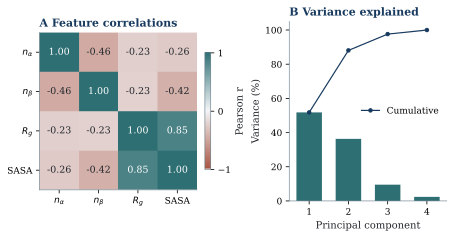
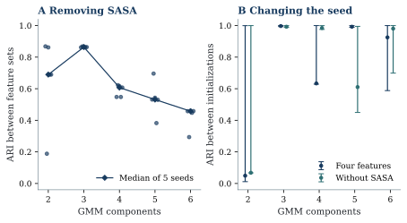

# RobustCluster-Aβ

**Reproducible analysis of amyloid-β40 conformational descriptors**

Scientific code audit · sampling diagnostics · feature-space sensitivity

[Read the report](report/report.pdf) · [Download the report](https://github.com/Alierkn/robustcluster-abeta/raw/refs/heads/main/report/report.pdf) · [Browse the source](https://github.com/Alierkn/robustcluster-abeta/tree/main/src/robustcluster_abeta) · [Download source ZIP](https://github.com/Alierkn/robustcluster-abeta/archive/refs/heads/main.zip)

[Code guide](docs/CODE_GUIDE.md) · [Reproduction instructions](REPRODUCIBILITY.md) · [Evidence and scope](docs/PUBLICATION_READINESS.md)



*Observed descriptor correlations and PCA diagnostics from the supplied biased trajectories. These plots describe the available sample; they do not estimate equilibrium populations. [Source manifest](results/manifests/20260921T011959-583b4421.json).*

RobustCluster-Aβ is a curricular internship research project by **Ali Erkan Ocaklı**, Data Analysis L-31, University of Messina. It examines how computational choices affect the interpretation of Aβ40 conformational descriptors and makes the analysis inspectable through modular Python code, numerical tests, saved outputs and a LaTeX report.

The project distinguishes the published workflow of [Cadenelli et al. (2026)](https://pubs.acs.org/doi/10.1021/acs.jpcb.6c01000), an audited implementation of that workflow, and a separate robustness extension. The completed results concern descriptor diagnostics and an unweighted Gaussian-mixture feature-ablation pilot. **The published equilibrium-clustering reproduction is incomplete:** the complete FES passed numerical validation, but its energy units and construction provenance remain unresolved.

## What is available

| Deliverable | Evidence and scope |
|---|---|
| [Academic report](report/report.pdf) | Scientific background, methods, audit, observed results and limitations; editable [LaTeX source](report/report.tex) |
| [Modular Python package](src/robustcluster_abeta) | Input validation, DPC, consensus, FES interpolation, weighting, diagnostics and independent experiments |
| [Descriptor diagnostics](results/manifests/20260921T011959-583b4421.json) | Real data: 300,003 frames across three replicas; correlation, PCA, distributions and autocorrelation diagnostics |
| [GMM sensitivity pilot](docs/GMM_ABLATION_PILOT.md) | 50 real-data fits: two feature spaces, five component counts and five seeds; all reported convergence |
| [Tests](tests) and [QA record](docs/FINAL_QA.md) | Analytic and synthetic checks of numerical behavior; these are not additional biological observations |
| [Method audit](METHOD_AUDIT.md) and [open questions](docs/OPEN_QUESTIONS.md) | Corrections, unresolved choices and prerequisites for further scientific claims |

No Aβ42 analysis, unbiased kinetic inference, atomic representative structures or Leonardo execution is claimed. The original supplied script and raw inputs are preserved locally and excluded from redistribution pending permission from their owners.

## Quick start: software checks without private data

Download the [source ZIP](https://github.com/Alierkn/robustcluster-abeta/archive/refs/heads/main.zip) and extract it, or clone the repository:

```bash
git clone https://github.com/Alierkn/robustcluster-abeta.git
cd robustcluster-abeta
```

From the project directory, create an isolated environment. Python 3.12 is the recorded development environment.

```bash
python3.12 -m venv .venv
source .venv/bin/activate
python -m pip install -r requirements-lock.txt
python -m pip install --no-deps -e .
python -m pytest -q
python -m ruff check src tests scripts
robustcluster --help
```

On Windows, activate the environment with `.venv\Scripts\activate` instead. Test execution needs no private inputs or network access after dependencies have been installed. The lock file records the tested package versions; a different platform or dependency set needs its own validation record.

## Inspect the completed extension



*Four descriptors versus the same representation without SASA, evaluated on identical frame identities. The curves summarize five paired seeds per component count. Variation across runs is not a confidence interval. [Analysis protocol and interpretation](docs/GMM_ABLATION_PILOT.md) · [Figure manifest](results/manifests/20261103T142638-b16e0fbe.json).*

The pilot asks whether correlated features can nevertheless change a geometric partition. It does not establish a preferred biological family count. Gaussian components are not assumed to be metastable states, and raw assigned-frame fractions are not equilibrium populations.

## Run analyses with authorized inputs

Follow [data provenance instructions](data/README.md), compare input SHA256 values with the [inventory](docs/PROJECT_INVENTORY.md), and retain the original files unchanged. Commands below require the descriptor file at the configured location:

```bash
robustcluster validate --config config/paper_reproduction.yaml
robustcluster diagnostics --config config/robustness.yaml
robustcluster gmm-ablation --config config/gmm_ablation.yaml
```

These commands create new run directories rather than replacing the evidence used in the report. The independent GMM pilot does not require an FES.

The reproduction and DPC robustness stages additionally require a complete, provenanced FES with verified energy units. With the current configuration, they terminate as `BLOCKED`:

```bash
robustcluster reproduce --config config/paper_reproduction.yaml --profile smoke
robustcluster robustness --config config/robustness.yaml --experiment seed-pilot
```

Every analysis command records a resolved configuration, input/output hashes, software versions, seeds, runtime and sampled process-tree peak memory. Exit codes are **0: SUCCESS**, **2: BLOCKED**, **3: FAILED**. A file's presence alone is not evidence that its producing stage succeeded.

## Scientific modes and execution profiles

`paper_reproduction` retains the specified four-descriptor baseline, DPC thresholds, source-informed raw marginal Wasserstein scaling and final-bias weighting. `robustness_extension` keeps alternative choices separate. The consensus distance is a norm of independent one-dimensional Wasserstein distances, not joint four-dimensional optimal transport.

| Profile | Discovery group size | Discovery groups | Default seeds | Purpose |
|---|---:|---:|---:|---|
| Smoke | 3,000 | At most 2 | 2 | Software and feasibility checks |
| Medium | 10,000 | At most 3 | 5 | Resource and sensitivity checks |
| Full | 30,000 | All | 20 | Production preparation; disabled pending review |

The separate five-seed DPC pilot overrides the profile's seed count. These profiles are defined for the DPC pipeline; the completed GMM experiment has its own [configuration](config/gmm_ablation.yaml). Reducing discovery groups does not discard analysis frames from final assignment. Full production has not been performed.

## Rebuild the report

Saved numerical outputs and figure assets are included, so report compilation does not require the raw simulation inputs. Install LuaLaTeX, Biber and the packages/fonts specified in [the preamble](report/preamble.tex), then run:

```bash
python scripts/build_report.py --tex-bin /path/to/texlive/bin/platform
```

For numerical-asset regeneration, release verification and the distinction between regenerating a report and rerunning its science, see [REPRODUCIBILITY.md](REPRODUCIBILITY.md). The [release manifest](release_manifest.json) identifies the selected report and QA runs; historical builds remain labeled as history. Generated editorial illustrations are qualitative and have [separate provenance](docs/ARTWORK_QA.md).

## Repository map

```text
config/                  Recorded scientific settings and resource profiles
src/robustcluster_abeta/  Modular analysis package and CLI
scripts/                 Figure, report and release entry points
workflows/               Snakemake orchestration
tests/                  Analytic and synthetic software checks
results/                 Run-specific tables, figures, logs and manifests
report/                  LaTeX sources, assets and compiled report
docs/                    Method mapping, evidence register and decisions
hpc/leonardo/            Parameterized templates; no executed jobs
```

See the [code guide](docs/CODE_GUIDE.md) for module responsibilities, data flow and companion-code links. Contributions should follow [CONTRIBUTING.md](CONTRIBUTING.md).

## Citation and rights

Use [CITATION.cff](CITATION.cff) to cite the software and cite the [primary study](https://pubs.acs.org/doi/10.1021/acs.jpcb.6c01000) separately for the published methodology. No software DOI has been assigned. The report is an internship research report, not a peer-reviewed article.

Historical run records retain local filesystem paths to preserve their original hashes; these paths describe the original execution and are not portable input settings. Raw inputs and private correspondence are not distributed.

New project code and documentation use [BSD-3-Clause](LICENSE). This does not relicense supplied data, legacy code, third-party publications, institutional logos or companion-project material. The VMD and GROMACS MCP repositories are independent projects linked for inspection; they are not dependencies of this descriptor pipeline.

Publication scope and fresh-history policy: [PUBLIC_RELEASE.md](docs/PUBLIC_RELEASE.md). External checker evidence is recorded separately in [AI_CHECKER_REVIEW.md](docs/AI_CHECKER_REVIEW.md); it is not a scientific validation score.

## Revised report v0.3.0

The report has **19 main-text pages, 36 pages including front matter, references and appendices**. It uses 32 cited references, 11 pt Libertinus typography, larger vector-plot labels and the approved illustrated cover. Numbered method steps, an audit comparison table and two short paired explanations complement normal scientific prose. The hierarchy and reading structures draw on inspected JMLR, LiveCoMS and PLOS PDFs; see the [design research](docs/DESIGN_RESEARCH_V030.md).

The student's confirmed GROMACS, VMD and Python use is described separately from their personal VMD MCP and GROMACS MCP projects. The [learning evidence map](docs/rebuild/LEARNING_EVIDENCE_MAP.md) and [complete-rebuild record](docs/rebuild/REBUILD_RECORD.md) retain that distinction.

A new [external checker comparison](docs/AI_CHECKER_REVIEW_V030.md) used one frozen 232-word abstract excerpt: Sapling returned 99.9% AI, QuillBot 0% likely AI, and GPTZero required registration. These conflicting outputs are not a whole-report authorship result or scientific validation. The checked abstract is unchanged; assistance and generated-art disclosures remain in the report.

The requested equilibrium analysis received a fresh [readiness review](docs/EQUILIBRIUM_READINESS_V030.md). Descriptor validation succeeded, but the reproduction preflight stopped before clustering or weighting because FES units/construction remain unverified. No equilibrium population or new molecular fit was produced.

### Editorial history

The [v0.2.0 rebuild](docs/rebuild/REBUILD_RECORD.md), [v0.1.1 design research](docs/EDITORIAL_DESIGN_RESEARCH_V011.md) and [v0.1.2 readability record](docs/PROSE_READABILITY_V012.md) remain available. Earlier checker inputs and outcomes stay attached to their [historical excerpts](docs/AI_CHECKER_REVIEW_REVISION3.md); they are not controlled before/after comparisons with the new review.
